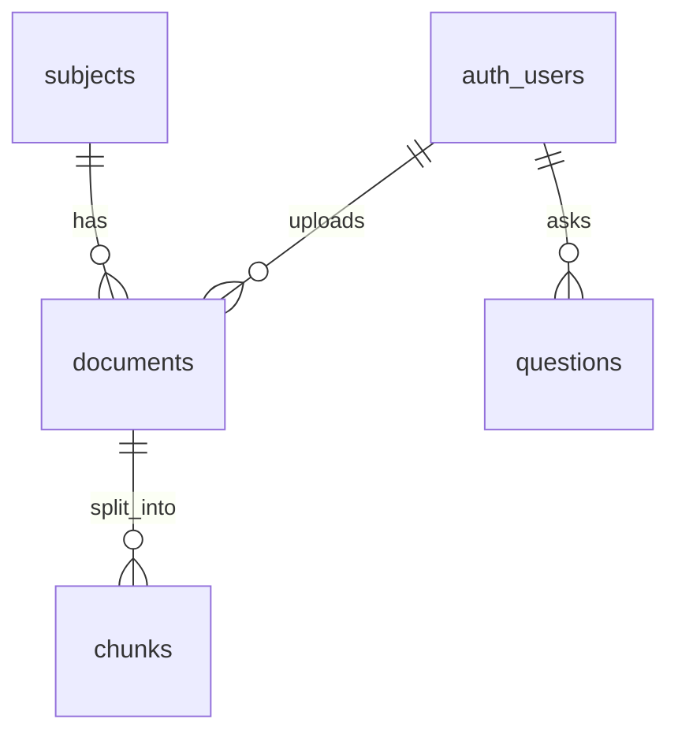
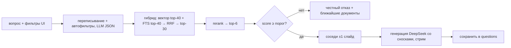

# ТЗ — Study RAG

Версия 0.1 (2026-10-11), статус: на согласовании.

## 1. Идея

Веб-приложение «учебный ассистент» для группы КИ. Студент задаёт вопрос по учёбе («чем мьютекс отличается от семафора?», «что сдавать по ЛР 3 у Ибрагимовой?») и получает ответ только по материалам группы за 5 семестров — лекциям, методичкам, презентациям, отчётам — со сносками на документ и слайд/страницу. Если ответа в материалах нет, ассистент так и говорит.

Отличие от NotebookLM / ChatGPT Projects: корпус на сотни документов с метаданными (предмет, семестр, преподаватель, тип), фильтры и автофильтры по ним, ссылка на конкретный слайд, общий закрытый корпус на группу.

## 2. Роли и доступ

- **Пользователь** — один тип: Дима, Ксюша, проверяющий. Аккаунты создаются вручную в Supabase, регистрация отключена.
- Все пользователи видят и редактируют общую библиотеку (предметы, документы).
- История вопросов — у каждого своя.

## 3. User stories

| # | Как пользователь, я хочу… | чтобы… |
|---|---|---|
| US1 | войти по email и паролю | материалы видели только свои |
| US2 | задать вопрос в чате и видеть ответ по мере генерации | не ждать полный ответ |
| US3 | видеть у ответа сноски [1], [2] с документом и слайдом/страницей и открыть источник на нужном месте | проверить ответ |
| US4 | ограничить поиск предметом, семестром, преподавателем, типом документа | не получать ответ из другого курса |
| US5 | чтобы ассистент сам понял из вопроса предмет/преподавателя/номер ЛР | не выставлять фильтры руками |
| US6 | получить честное «в материалах этого нет» и ближайшие документы | не получить выдумку |
| US7 | оценить ответ 👍/👎 | собрать фидбек для улучшения поиска |
| US8 | видеть историю своих вопросов и открыть старый ответ | не спрашивать заново |
| US9 | создавать, переименовывать и удалять предметы | вести справочник |
| US10 | загрузить документ (.md) с метаданными и видеть статус индексации | пополнять корпус без программиста |
| US11 | редактировать метаданные документа и удалять документ | исправлять ошибки разметки |
| US12 | просматривать библиотеку с фильтрами и поиском по названию | найти нужную методичку |
| US13 (разработчик) | прогнать eval по контрольным вопросам и получить hit@5 / MRR | сравнивать настройки поиска цифрами |

## 4. Схема БД



```sql
create extension if not exists vector;

create table subjects (
  id          uuid primary key default gen_random_uuid(),
  name        text not null check (length(name) between 2 and 200),
  short_name  text not null unique check (short_name ~ '^[a-z0-9_-]{2,40}$'),
  semester    smallint not null check (semester between 1 and 8),
  teacher     text,
  created_at  timestamptz not null default now(),
  unique (name, semester)
);

create table documents (
  id            uuid primary key default gen_random_uuid(),
  subject_id    uuid not null references subjects(id) on delete cascade,
  title         text not null check (length(title) between 1 and 300),
  doc_type      text not null check (doc_type in ('лекция','презентация','методичка','задание','отчёт',
                  'вопросы к экзамену','билеты','конспект','практика','пособие','другое')),
  teacher       text,                -- если отличается от subjects.teacher (лабы у другого преподавателя)
  source        text not null check (source in ('blackboard','telegram','downloads','upload')),
  source_path   text,                -- хлебные крошки из сбора
  storage_path  text not null,       -- исходный .md в Storage (bucket documents, private)
  sha256        text not null unique, -- дедуп
  units         int,                 -- число слайдов/страниц
  status        text not null default 'processing' check (status in ('processing','ready','failed')),
  error         text,
  created_by    uuid references auth.users(id) default auth.uid(),
  created_at    timestamptz not null default now(),
  updated_at    timestamptz not null default now()
);

create table chunks (
  id           bigint generated always as identity primary key,
  document_id  uuid not null references documents(id) on delete cascade,
  unit_label   text not null,        -- 'Слайд 5' | 'Страница 12' | 'Раздел: Введение'
  unit_no      int,                  -- номер слайда/страницы, для соседей ±1
  part         smallint not null default 0, -- часть длинной страницы
  header       text not null,        -- 'ОС · 3 сем · Петров И.И. · лекция · Лекция 5 · Слайд 5'
  content      text not null,        -- дословный текст (+ описания картинок)
  embedding    vector(1024),
  tsv          tsvector generated always as (to_tsvector('russian', header || ' ' || content)) stored,
  unique (document_id, unit_no, part)
);
create index on chunks using hnsw (embedding vector_cosine_ops);
create index on chunks using gin (tsv);
create index on chunks (document_id, unit_no);

create table questions (
  id               uuid primary key default gen_random_uuid(),
  user_id          uuid not null references auth.users(id) default auth.uid(),
  question         text not null check (length(question) between 2 and 2000),
  rewritten_query  text,
  filters          jsonb,            -- {subject_ids, semester, teacher, doc_type, source:'ui'|'auto'}
  answer           text,
  sources          jsonb,            -- [{n, chunk_id, document_id, title, unit_label, score}]
  refused          boolean not null default false,
  feedback         smallint check (feedback in (-1, 1)),
  model            text,
  latency_ms       int,
  created_at       timestamptz not null default now()
);
create index on questions (user_id, created_at desc);
```

Решения:
- Метаданные для фильтров не дублируем в `chunks` — фильтр через join с `documents`/`subjects` в SQL-функции. Корпус — тысячи чанков, join дешёвый. Для HNSW с фильтром включаем `hnsw.iterative_scan = relaxed_order` (pgvector ≥ 0.8), чтобы фильтр не съедал top-k.
- `vector(1024)`: все кандидаты в эмбеддеры отдают 1024 (bge-m3, jina-v3) или умеют урезать размерность (text-embedding-3, Qwen3-Embedding). Модель выбираем по eval, схема не меняется.
- Оригинальный .md храним в Storage: из него перестраиваем чанки при смене чанкера без повторной загрузки.

**RLS:**
- `subjects`, `documents`, `chunks`: `authenticated` — select/insert/update/delete всё; `anon` — ничего.
- `questions`: только свои строки (`user_id = auth.uid()`).
- Storage bucket `documents`: private, доступ `authenticated`.

**SQL-функции (RPC):**
- `match_chunks(query_embedding vector, query_text text, filters jsonb, match_count int)` — гибридный поиск с RRF (раздел 6).
- `neighbor_chunks(chunk_ids bigint[])` — чанки `unit_no ± 1` тех же документов.

## 5. Экраны

| Экран | Путь | Содержимое | Состояния |
|---|---|---|---|
| Вход | `/login` | email, пароль, без ссылки на регистрацию | ошибка входа, загрузка |
| Чат | `/` | поле вопроса; панель фильтров (предмет, семестр, преподаватель, тип), на мобильном — выезжает; ответ стримом со сносками `[n]`; карточки источников (документ, слайд, фрагмент) со ссылкой на просмотр; чипы автофильтров («искал в: ОС, 3 сем» ✕); 👍/👎 | пусто (подсказки примеров), генерация, отказ «нет в материалах», ошибка API с повтором |
| Библиотека | `/library` | список предметов по семестрам; документы предмета таблицей; поиск по названию, фильтры; создание/редактирование/удаление предмета (модалка с формой); редактирование метаданных и удаление документа (подтверждение); статус индексации | пусто, загрузка, ошибка, подтверждение удаления |
| Документ | `/library/[id]` | метаданные, текст .md с якорями `#unit-5` на каждый слайд/страницу; переход из сноски скроллит к нужному месту | не найден, загрузка |
| Загрузка | `/upload` | файл .md (≤ 5 МБ); поля предмет, тип, название, преподаватель — предзаполняются из frontmatter; прогресс; итог «N чанков» | валидация, дубликат (sha256), ошибка индексации |
| История | `/history` | свои вопросы по датам, поиск, фильтр «с 👎»; открытие сохранённого ответа с источниками | пусто, загрузка |

Общее: шапка с навигацией и выходом, адаптив от 360 px, Tailwind.

## 6. RAG-пайплайн

### Индексация (загрузка и импорт корпуса)

1. Разбор frontmatter (title, subject, semester, teacher, doc_type, source, source_path, sha256).
2. Разбиение по заголовкам `## Слайд N` / `## Страница N` / `## Раздел: …`: одна единица = один чанк. Пустые единицы пропускаем, нумерацию берём из заголовка. Блоки `> [!image]` и заметки докладчика остаются в тексте чанка.
3. Единица длиннее ~2000 символов режется по абзацам на части с перекрытием ~200 символов (`part` 0, 1, …).
4. `header` = предмет · семестр · преподаватель · тип · название документа · единица. Эмбеддинг считается от `header + content`, FTS — тоже.
5. Эмбеддинги батчами, запись чанков, `documents.status = ready` (или `failed` + `error`).
6. Импорт всего корпуса из `output/` — CLI-скрипт `npm run ingest -- <папка>` с секретным ключом, локально. Использует тот же код разбора, что и загрузка через UI. Повторный импорт пропускает документы с известным sha256.

### Ответ на вопрос (`POST /api/ask`)



1. **Валидация** (zod), проверка сессии.
2. **Переписывание + автофильтры.** Один вызов LLM с JSON-ответом. На входе вопрос и справочник предметов (название, short_name, семестр, преподаватель). На выходе: поисковый запрос без разговорного мусора, раскрытые сокращения («ОС» → «операционные системы»), найденные предмет / семестр / преподаватель / тип / номер ЛР. Фильтры из UI главнее автофильтров. Автофильтры мягкие: если с ними после rerank ничего не прошло порог, повторяем поиск без них.
3. **Гибридный поиск** — `match_chunks`: вектор (cosine, top-40) + FTS (`websearch_to_tsquery('russian', …)`, `ts_rank_cd`, top-40) → Reciprocal Rank Fusion, `k = 60` → top-30.
4. **Rerank** cross-encoder через API → top-6.
5. **Порог.** Если лучший скор reranker'а ниже порога (подбирается по вопросам `нет ответа` из eval) — отказ: «в материалах не нашёл» + 3 ближайших документа ссылками. LLM не вызывается.
6. **Соседи ±1:** к каждому из top-6 добавляем соседние слайды/страницы, склеиваем подряд идущие в один блок источника.
7. **Генерация.** Системный промпт: отвечать только по источникам; каждое утверждение — со сноской `[n]`; если источники отвечают частично — сказать, чего нет; по-русски; термины как в материалах. Ответ стримится; список источников приходит первым событием.
8. **Сохранение** в `questions`: вопрос, переписанный запрос, фильтры, ответ, источники, `refused`, модель, время.

### Качество (eval)

- CLI `npm run eval -- questions.csv` (строки `keep=1`): только поиск, без генерации. Метрики hit@5, MRR@10, доля правильных отказов на `нет ответа`; для `сравнение` — попадание всех ожидаемых единиц в top-10.
- Сравниваем конфигурации: FTS / вектор / гибрид / + rerank / + переписывание / разные эмбеддеры. Таблица «до/после» в `docs/eval.md` (только агрегаты, без текста материалов).
- `questions.csv` содержит фрагменты материалов — в репо не кладём.

## 7. API (Route Handlers, `src/app/api`)

Все маршруты требуют сессию (иначе 401). Ввод валидируется zod (400 с описанием полей).

| Метод | Путь | Что делает |
|---|---|---|
| POST | `/api/ask` | `{question, filters?}` → стрим (SSE): `sources`, `token`…, `done {question_id}` |
| GET | `/api/subjects` | список предметов |
| POST | `/api/subjects` | создать (409 при дубле) |
| PATCH / DELETE | `/api/subjects/[id]` | изменить / удалить (каскадом документы) |
| GET | `/api/documents` | `?subject_id&semester&teacher&doc_type&q&page` |
| POST | `/api/documents` | multipart: файл .md + метаданные → Storage → индексация; 409 при совпадении sha256 |
| GET / PATCH / DELETE | `/api/documents/[id]` | документ с текстом / изменить метаданные (пересчёт `header` и эмбеддингов) / удалить с файлом |
| GET | `/api/questions` | история пользователя, пагинация |
| PATCH | `/api/questions/[id]` | `{feedback: -1 \| 1 \| null}` |
| GET | `/api/health` | для Docker и smoke-проверки |

Auth: `@supabase/ssr`; `src/proxy.ts` (в Next.js 16 так называется бывший `middleware.ts`) обновляет сессию и редиректит на `/login`. Это только оптимистичная проверка, в каждом маршруте пользователь проверяется заново.

## 8. Стек и инфраструктура

- Next.js 16 (App Router, TS), Tailwind 4, zod, `@supabase/ssr` + `@supabase/supabase-js`, Vitest.
- Supabase: Postgres + pgvector + FTS `russian`, Auth (email/пароль, signup off), Storage. Миграции в `supabase/migrations/`, применяются `supabase db push`.
- LLM: DeepSeek через OpenRouter (модель в `LLM_MODEL`). Эмбеддинги и reranker — по итогам eval. Кандидаты: эмбеддинги через OpenRouter (наличие endpoint — UNCONFIRMED, проверить на этапе 4) или Jina; reranker — Jina reranker-v2 multilingual или Cohere rerank-v3.5.
- В OpenRouter включить запрет на обучение на запросах: в провайдер уходят фрагменты наших материалов.
- Vercel: автодеплой из `main`, превью на PR. Секретный ключ Supabase в Vercel не кладём — приложение работает от сессии пользователя и RLS.
- GitHub Actions: `lint` → `tsc --noEmit` → `vitest run` → `next build` на каждый push/PR.
- Dockerfile: multi-stage, `output: 'standalone'`, `docker run -p 3000:3000 --env-file .env.local`.

## 9. Тесты

- Unit (Vitest): разбор frontmatter и единиц (нумерация, пустые слайды, `> [!image]`, `## Раздел:`), нарезка длинных страниц, сборка `header`, склейка соседей, разбор сносок `[n]` в ответе, zod-схемы.
- Фикстуры — синтетические .md в формате сбора, без материалов КИ.
- Качество поиска — eval-скрипт (раздел 6), не CI.

## 10. Критерии приёмки

1. Без входа любой путь, кроме `/login`, редиректит на вход; API отвечает 401. Регистрации нет ни в UI, ни в Supabase.
2. Предмет создаётся, редактируется и удаляется из UI; удаление предмета удаляет его документы и чанки.
3. Загрузка .md из формата сбора создаёт документ и чанки, число чанков = числу непустых единиц (+ части длинных). Повторная загрузка того же файла даёт 409.
4. Метаданные документа редактируются, документ удаляется вместе с файлом в Storage и чанками.
5. Ответ на вопрос из корпуса приходит стримом, у каждого утверждения есть сноска, сноска открывает документ на нужном слайде/странице.
6. Фильтры UI ограничивают источники; автофильтры видны чипами и снимаются.
7. На вопрос без ответа в корпусе — отказ без выдуманного ответа.
8. 👍/👎 сохраняется и видно в истории; история показывает только свои вопросы (проверено вторым аккаунтом).
9. Eval: hit@5 ≥ 0.8, правильные отказы ≥ 0.8 на `нет ответа`; таблица «до/после» в `docs/eval.md`.
10. Все экраны работают на 360 px и на десктопе; формы показывают ошибки валидации; везде есть состояния загрузки и ошибки.
11. CI зелёный (lint, типы, тесты, build); push в `main` деплоит на Vercel; `docker build` + `docker run` поднимает приложение, `/api/health` отвечает 200.
12. В git нет материалов КИ и секретов.

## 11. Вне рамок (P2, если успеем)

- Загрузка pdf/docx/pptx с конвертацией в .md на сервере (сейчас конвертирует сбор данных).
- Экран eval в UI (сейчас CLI + `docs/eval.md`).
- Дедуп почти-дублей внутри корпуса (точные дубли — по sha256).
- Мультиходовой чат с учётом предыдущих вопросов.
